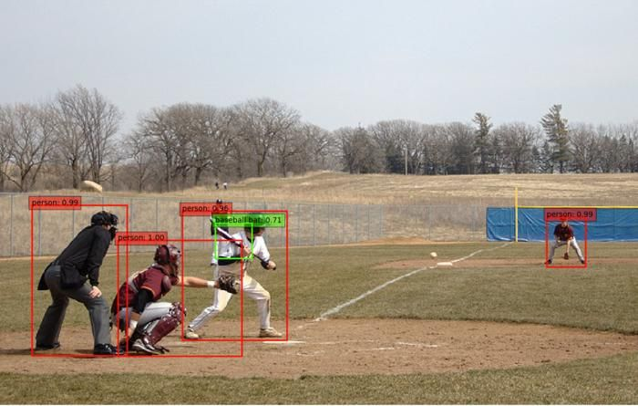
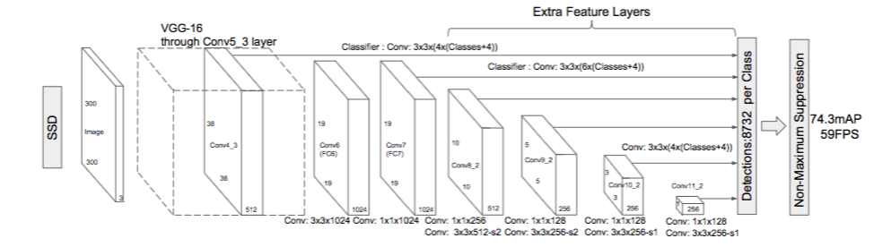
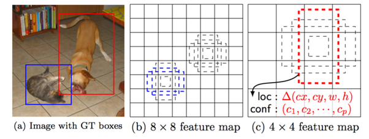
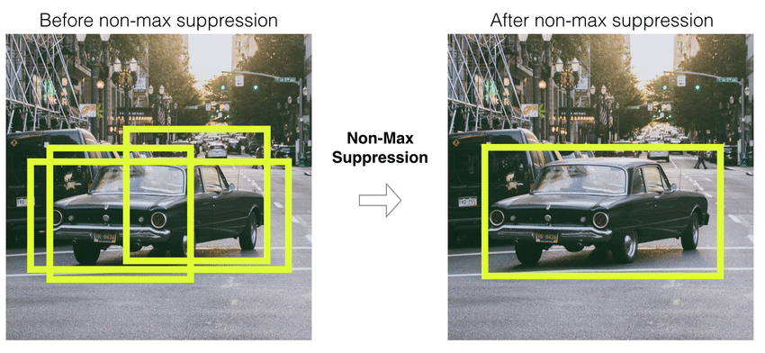

## Objective

Students should understand the principles of object detection with single-stage object detection networks,
and be able to use a pretrained object detection model available in Matlab (Yolo / SSD).

## Theoretical aspects

Single Shot Detector (SSD) is a CNN network architecture designed for fast detection (e.g. localization) of objects in an image.

### Object detection

Object detection = locating certain objects in an image, and indicating their class.

An example[^ObjDetEx] is provided in the image below.



[^ObjDetEx]: image from [https://lambdalabs.com/blog/how-to-implement-ssd-object-detection-in-tensorflow/](https://lambdalabs.com/blog/how-to-implement-ssd-object-detection-in-tensorflow/)

The model is trained on a series of images from different categories (e.g. person, baseball bat, car, bicycle, ball, etc.).

When predicting on a new image, the model returns a list of detected objects, each object having the following data:

1. The **bounding box** surrounding the object. This is defined by 4 pixel coordinates (e.g. bottom=140, top=300, left=74, right=128), but can come in different varieties:

   - (left, top, right, bottom), or in another order
   - (left, top, width, height)
   - (center_x, center_y, semi-width, semi-height)
   - etc

2. The **class** of the object (i.e. it is a person or a bicycle). The class will come with a certain confidence score (probability), just like we saw in Lab4 for classification networks.
   The model estimates a score for each possible class, and the highest score wins.

There may be some variations, depending on the model architecture used. For example, the YOLO models provide an additional "objectness" score indicating the confidence that the box is an actual object, regardless of class.

### The SSD network architecture

The SSD (Single-Shot Detector) model architecture is presented below[^SSD]:



[^SSD]: image from [https://towardsdatascience.com/understanding-ssd-multibox-real-time-object-detection-in-deep-learning-495ef744fab](https://towardsdatascience.com/understanding-ssd-multibox-real-time-object-detection-in-deep-learning-495ef744fab)

YOLO models have a different, but similar, architecture.

The **input** of the network is a fixed-size $W \times H \times 3$ image tensor.

The **outputs** of the network are the parameters for all $N$ detection boxes:

- A matrix of $N \times 4$ values with the predicted box displacements/distortions with respect to all the $N$ anchor boxes (i.e. offset x, offset y, height scaling, width scaling).
- A matrix of $N \times C$ with the predicted class scores for all the $N$ boxes. $C$ is the number of distinct classes in the dataset.

$N$ is the total number of predicted boxes over all the image. It can be very large, e.g. 8732 boxes for a $300 \times 300$ image. The exact count is driven by the anchor box design (scales and aspect ratios assigned to each feature map location).

For a larger $1024 \times 640$ image, the number can be much larger, over 90000 (speaking from experience). Of course, it depends on the parameters chosen by the designer.

### Output encoding and decoding

We have an image with one box around an object, done by a human (ground-truth). How do we tell the network what it should detect, in the training phase?

**Output Encoding**: Before training, we must convert the ground-truth box into displacements with respect to the anchor boxes of the network. This is known as **encoding**: we convert the desired box in the native format of the models' output. During training, we show the image to the network, and we "tell it" to predict the correct displacements. An example is provided below[^Enc].



[^Enc]: image from the SSD paper [https://arxiv.org/abs/1512.02325](https://arxiv.org/abs/1512.02325)

**Output Decoding**: When the network runs, it outputs the predicted displacements with respect to the anchor boxes. Afterwards, from these displacements we compute the final object position (in pixels). This is known as **decoding** the results of the network, since we translate the native network output into our desired format (pixels). This is typically done outside the network itself.

### Non-Max Suppression



This is a key post-processing step in most object detectors.

A single object is predicted by many anchor boxes. As a result, we will have **many predicted boxes around one object** in the image, with slightly different values. We want just one box. Non-Max Suppression (NMS) is a procedure to select a single box out of a group of overlapping boxes (the one with the highest confidence score), and ignore all the other overlapping ones. An example is illustrated below[^NMS].

[^NMS]: image from [Incremental Training for Image Classification of Unseen Objects](https://www.researchgate.net/publication/345061606_Incremental_Training_for_Image_Classification_of_Unseen_Objects
)

### The model

The network model is defined by the sequence of convolutional layers in the architecture. Open the network in Matlab in order to inspect the architecture in detail.

### The model parameters

The SSD model parameters are the parameters of all the convolutional layers. There are no fully-connected layers in the SSD network, and neither in YOLO.

### The cost function

The model produces two kinds of data:

- box locations (expressed as displacements/distortions with respect to the anchor boxes)
- box classification scores

When training, the predicted boxes are compared to the **real ground-truth** boxes available. For each ground-truth box, the best predicted box is selected (the predicted box with the correct class which overlaps the most with it), and the error is computed based on two terms:

1. The **localization error**: typically is the absolute difference between the coordinates or displacements of the ground-truth box and the predicted box.

2. The **classification error**, which compares the class scores of the predicted box with the true ground-truth class. The cross-entropy loss function is typically used, just like it is used for all other classification tasks.

   Besides the predicted boxes which are compared to the ground-truth, there are many predicted boxes which correspond to **no** ground truth box. There are a few different methods how to treat these, some methods (e.g. Focal Loss) being better than others.

### Training

Training is done with **backpropagation** and gradient descent (or some variant of it).

**Backpropagation** = the technique to compute the derivatives of $J$ with respect to all parameters in the network.

This is similar to all CNN networks.

### Evaluation metrics

Detection quality is usually reported with Average Precision (AP) for each class and mean AP (mAP) over all classes. Lowering detection thresholds increases recall (fewer missed objects) but can lower precision (more false positives); raising thresholds does the opposite. Keep the precision/recall trade-off in mind when adjusting score/overlap thresholds in the exercises.

**Precision** = fraction of reported detections that are correct (true positives / (true positives + false positives)).  
**Recall** = fraction of all real objects that are correctly detected (true positives / (true positives + false negatives)).

## Matlab tutorials walkthrough

Practical work is based on 2 Matlab examples:

1. Using the pretrained detectors available in [Mathworks Github](https://github.com/matlab-deep-learning/MATLAB-Deep-Learning-Model-Hub#object-detection-)

   - Use [EfficientDet](https://github.com/matlab-deep-learning/pretrained-efficientdet-d0)
   - Download the zip file of the whole repository and unzip in Matlab Online
   - Run the `efficientDetD0ObjectDetectionExample.m` file

2. Change the thresholds in `postprocess.m` file

Other tutorials:

1. [Getting Started with SSD Multibox Detection](https://www.mathworks.com/help/vision/ug/getting-started-with-ssd.html)
2. [Anchor Boxes for Object Detection](https://www.mathworks.com/help/vision/ug/anchor-boxes-for-object-detection.html)
3. [Object Detection Using SSD Deep Learning](https://www.mathworks.com/help/vision/ug/object-detection-using-single-shot-detector.html)
4. [Object Detection Using YOLO v4 Deep Learning](https://www.mathworks.com/help/vision/ug/object-detection-using-yolov4-deep-learning.html)


## Practical work

### Exercise 1 - Run on another image

- Run the EfficientDet object detector on the image `Richarlison.jpg`, and identify how many objects are detected, and their class.
- Read the expected input resolution and the output tensor dimensions of the EfficientDet D0 network (e.g., via `analyzeNetwork(detector.Network)` or by inspecting `detector.Network.InputSizes` and the prediction head layer sizes).
- Set the overlap threshold to 0.01 and run it on the `Richarlison.jpg` image. What happens? Then set it to 0.9 and run it again. What does this threshold do?
- Reset the overlap threshold to 0.5, and set the score threshold to 0.02, and run it on the `Richarlison.jpg` image. What happens? What does this threshold do?
- Set a breakpoint on line 34 of the `postprocess.m` file and investigate the size of the `scores` vector. What is its size? What does this number represent?

### Exercise 2 - Aspect ratio

- Run the EfficientDet object detector on the image `CarWide.jpg`. Is the car detected? If yes, with what score?
- Identify the input resolution of the EfficientDet network.
- Use the Matlab function `imresize()` to resize the image `CarWide.jpg` to the input resolution, and display it with `imshow()`.

  What happens with the car image? This is the image which goes into the object detector network. Do you think this is a problem?

  Tip: plain resizing can distort aspect ratio and hurt detection scores. Try a resizing that preserves aspect ratio (or compare both) and visualize how the car looks before feeding the network.

- Use any Windows tool to crop from the `CarWide.jpg` a square part containing the car, save it, and run the object detector on it.

  Does the detection score improve?

### Exercise 3 - Partial objects

- Use any Windows tool to crop from the `CarWide.jpg` a square part containing

  - about 3/4 of the car
  - about 1/2 of the car
  - about 1/4 of the car

- Save each image and run the object detector on each of them.  What is the detection score?

### Exercise 4 - YoloX

- Go to the YoloX object detector from here: https://github.com/matlab-deep-learning/Pretrained-YOLOX-Network-For-Object-Detection
- Using the Github example, run this detector on the same image `Richarlison.jpg`
- Filter the bounding boxes on the image:
  - Display only the object with the highest score
  - Display only the object whose center (the center of the box) is the left-most among all objects
  - Display only the non-person objects

- Identify the two threshold values in the `postprocess.m` function, the score threshold and the overlap threshold.
- Set both thresholds to 0.03 and display the results. How many objects are detected now?
- Set the score threshold to 0.1 and the overlap threshold to 0.8. How many objects are detected now?
- What is the total number of boxes predicted by the YoloX model?


### Exercise 5 - Non-max suppression

Write a small Matlab function called `IOU` which computes the intersection-over-union of two bounding boxes,
given as vectors `[left, right, bottom, top]`.

Use the `rectint()` function to compute the intersection of the boxes.

Note: `rectint()` expects `[x, y, width, height]`. Convert `[left, right, bottom, top]` to `[left, bottom, right-left, top-bottom]`.

```matlab
function result = IOU(box1, box2)

% Compute IOU of two boxes
% Each box is a 4-element vector: [left, right, bottom, top]

[x1, y1, w1, h1] = deal(box1(1), box1(3), box1(2) - box1(1), box1(4) - box1(3));
[x2, y2, w2, h2] = deal(box2(1), box2(3), box2(2) - box2(1), box2(4) - box2(3));
inter = rectint([x1, y1, w1, h1], [x2, y2, w2, h2]);
unionArea = w1 * h1 + w2 * h2 - inter;
result = inter / unionArea;

end
```

Use the function to compute the IOU of the following two bounding boxes:

```matlab
A = [50, 100, 120, 200];
B = [10, 80, 40, 140];
```

Bonus: plug `IOU` into a minimal NMS loop to keep the strongest boxes:

```matlab
function keep = simpleNMS(boxes, scores, iouThresh)
[~, order] = sort(scores, 'descend');
keep = [];
while ~isempty(order)
    i = order(1);
    keep(end+1) = i; %#ok<AGROW>
    rest = order(2:end);
    ious = arrayfun(@(j) IOU(boxes(i, :), boxes(j, :)), rest);
    order = rest(ious < iouThresh);
end
end
```

### Exercise 6 - SSD

1. Run the first steps of the [Object Detection Using SSD Deep Learning](https://www.mathworks.com/help/vision/ug/object-detection-using-single-shot-detector.html) tutorial,
   and stop before the creation of the SSD network.

2. Investigate the network architecture by running `analyzeNetwork()` on the network variable `lgraph`

   - How many layers are there?
   - What is the required size of the input image?
   - Which are the two output layers?
   - How many boxes are predicted in all?

3. Run the next steps of the tutorial, and observe the detected boxes on the image.

4. Download a similar image from the Internet and run the model on it. Are the objects detected well?

5. Locate the call to the `detect()` function and change the detection threshold to 0.01. What happens?

   - What happens if the threshold is set too low?
   - What would happen if the threshold is set too high?
   - What is the trade-off involved in choosing a value for the threshold?

6. Set the detection parameter 'SelectStrongest' to `false`: `detect(... 'SelectStrongest', false)`. Set the threshold to 0.001. What changes? How many detected boxes are now?

7. Set the detection parameter 'SelectStrongest' to `false`: `detect(... 'SelectStrongest', false)`. Reset the threshold to a reasonable value (e.g. 0.4). What changes? How many detected boxes are now?

   - Why do we have multiple boxes around a single object?
   - Imagine a procedure to keep only a single detection box around an object (this is known as **Non-Max Suppression (NMS)**)


8. Set the variable `doTraining` to `true` (or 1) and train the model. How fast does it work?

## Final questions

- When would you pick SSD versus YOLO for a real-time application?
- How would you tune score and overlap thresholds differently for high recall vs high precision use cases?
- What strategies help when input images have very different aspect ratios from the detector’s expected size?
